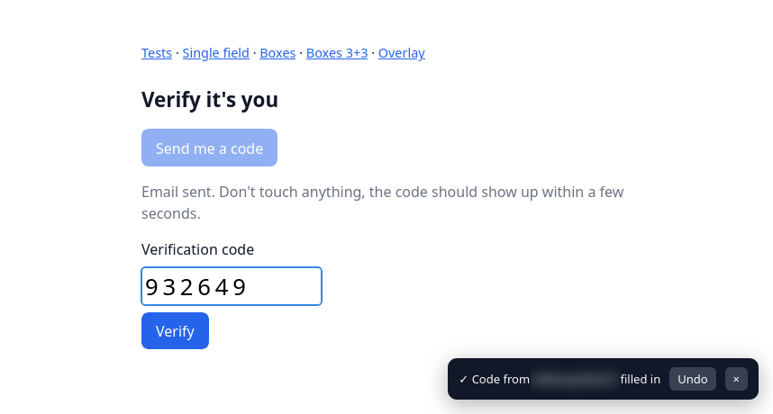
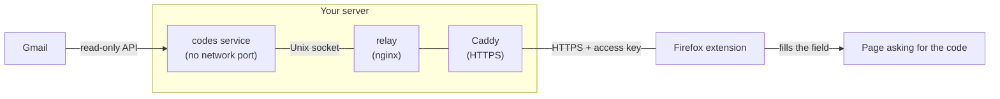

# codes-verification

**Email verification codes, typed in for you.** A small self-hosted service watches your Gmail, and a Firefox extension fills in the code as soon as the email arrives.

[](https://github.com/WilliamPltr/codes-verification/actions/workflows/ci.yml)


## Why

*"We've sent a code to your email."* So you open Gmail in another tab, wait, refresh, open the email, copy six digits, switch back, paste. Five times a day on a bad day.

Phones fixed this for SMS years ago. Now I ask for the code and look at the field: it's already there, three or four seconds later.

<p align="center"><br><sub>A real run: click, the email goes out, and 3.5 seconds later the code is in the field.</sub></p>

## How it works



- The **service** polls Gmail (every 10 s, every second while a page is waiting). It keeps only the code or sign-in link, the sender and the subject, for 10 minutes, in memory.
- The **relay** is the only part exposed to the Internet: `GET /v1/*` and `POST /v1/sms`, rate-limited, nothing else.
- The **extension** spots code fields (single field, one box per digit, invisible overlay inputs), asks your server for a code from *that site*, and fills it in. It never submits the form.

Detection is plain regular expressions, no AI and no third party. It skips order numbers, prices, postcodes, promo codes and years.

## Text messages (optional, iPhone)

Codes sent by SMS to your iPhone can arrive the same way. An iPhone **Shortcuts automation** forwards each text that contains a code to `POST /v1/sms`; nothing to install on the phone.

Texts carry no DMARC, so the safety net is **timing** and **a single owner**:

- an SMS code is kept **5 minutes** (`CODES_SMS_WINDOW`), in memory, and the text itself is dropped as soon as the code is read;
- it is filled into the page **where you are waiting for it** (the extension only asks while a code field is on screen), and **only the first site that takes it**: any other site gets nothing automatically afterwards;
- an SMS ending with the standard line `@example.com #123456` must match that site, like an email;
- the phone's key (`codes token add iphone --sms`) can only post texts, never read codes; a reading key can't post.

The shortcut, step by step (iOS 17 or later, tested wording in French and English):

1. On the server: `codes token add iphone --sms` (the key is shown once).
2. **Shortcuts → Automation → + → Message.** Set **Message contains** to `code` (the app needs a filter; create one automation per word you want, e.g. `code`, `OTP`, `vérification`). Choose **Run Immediately**, keep *Notify When Run* off.
3. New blank automation, then add the actions:
   - **Match Text** (regular expression `\d{4,8}`) in *Shortcut Input → Content*.
   - **If** *Matches* has no value → **Stop This Shortcut**. (So personal texts never leave the phone.)
   - **Get Contents of URL**: URL `https://codes.example.com/v1/sms`, Method **POST**, Header `Authorization` = `Bearer <key>`, Request Body **JSON** with two Text fields: `text` = *Shortcut Input → Content*, `from` = *Shortcut Input → Sender → Name*.
4. Run it once with the phone unlocked and answer **Always Allow** to the "send data to the domain" question.

Limits: the phone must be on and online; texts that iOS files under *Junk* may not trigger the automation.

## Security

- **A code only goes to the site that sent it.** Auto-fill requires the page's domain to match the sender's, compared with the [Public Suffix List](https://publicsuffix.org/) (so `phishing.com.ar` ≠ `mybank.com.ar`). Otherwise the code appears in the toolbar popup with a warning, behind two clicks.
- **Forged senders don't count.** Gmail must report a DMARC pass for the sender's domain, read from the header Gmail adds itself.
- Read-only Gmail access, through your own Google Cloud project.
- One revocable access key per browser, stored as a SHA-256 hash.
- `https` pages only, never into third-party frames, never over what you typed.
- Containers run non-root, read-only, with capabilities dropped.

Not covered: anyone using your unlocked browser sees the last 10 minutes of codes (as with a password manager), and whoever controls your server can read your Gmail.

## Requirements

- A Linux server with **Docker** and the Compose plugin, ports **80/443** open (or your own reverse proxy). 128 MB of RAM is enough; ARM and x86 both work.
- A **domain name** pointing to it, e.g. `codes.example.com`.
- A **Gmail** account, **Firefox 140+**, and a free **Mozilla account** to sign the extension.

## Setup

### 1. Clone and configure

```bash
git clone https://github.com/WilliamPltr/codes-verification.git ~/codes-verification && cd ~/codes-verification
cp .env.example .env
```

Point a DNS `A` record at the server and set `CODES_DOMAIN=codes.example.com` in `.env`.

### 2. Google OAuth client

1. [Create a project](https://console.cloud.google.com/projectcreate) and [enable the Gmail API](https://console.cloud.google.com/apis/library/gmail.googleapis.com).
2. In [Google Auth Platform](https://console.cloud.google.com/auth/overview), **Get started**: any app name, audience **External**.
3. In [Audience](https://console.cloud.google.com/auth/audience), **Publish app**. Apps left in "Testing" lose access after 7 days. No verification is needed for personal use.
4. In [Clients](https://console.cloud.google.com/auth/clients), create a **Desktop app** client and copy its ID and secret (the secret is shown only once) into `.env`:

```ini
GOOGLE_CLIENT_ID=1234567890-abc123.apps.googleusercontent.com
GOOGLE_CLIENT_SECRET=GOCSPX-...
```

### 3. Start

```bash
docker compose up -d --build
echo "alias codes='docker compose --project-directory ~/codes-verification exec codes codes'" >> ~/.bashrc && source ~/.bashrc
```

Caddy gets the Let's Encrypt certificate by itself. `curl https://codes.example.com/v1/health` should answer `{"ok": true, ...}`.

### 4. Connect Gmail

```bash
codes auth
```

Open the address it prints, choose your account, get past the "unverified app" screen (**Continue**, or **Advanced** then **Go to codes**), and allow read-only access. Google then redirects to `http://127.0.0.1:8765/...`, a page that won't load: that's expected. Copy that address and paste it in the terminal.

### 5. Create an access key

```bash
codes token add laptop
```

Keep the `cdx_...` key: it is shown only once. Use one key per browser.

### 6. Sign and install the extension

Firefox only installs extensions signed by Mozilla. Signing your copy is free, and "unlisted" keeps it private.

1. Get API credentials on the [addons.mozilla.org API keys page](https://addons.mozilla.org/developers/addon/api/key/).
2. Add them to `.env` with an ID of your own (unique on addons.mozilla.org):

   ```ini
   AMO_JWT_ISSUER=user:12345678:123
   AMO_JWT_SECRET=...
   CODES_EXTENSION_ID=codes@example.com
   ```

3. Run `python3 tools/sign.py`. After a minute or two you get `dist/codes-1.4.0-signed.xpi`, with your server address built in.
4. Copy it to your computer. In Firefox, open `about:addons`, click the gear icon, then **Install Add-on From File…**.

The extension asks for access to all websites so it can spot code fields. It only ever talks to your server.

> To just try it: `about:debugging` → **Load Temporary Add-on** → `extension/manifest.json` (removed when Firefox restarts).

### 7. Connect and test

The settings tab opens after the install, with the server already filled in. Paste the key, then click **Save and test**: you should see **Connected ✓**.

Then open `https://codes.example.com/test/` and click **Send me a code**. By default the server simulates the code. To test with a real email, fill in the `SMTP_*` settings.

## Daily use

Nothing to do: the code is filled in when the email arrives, with an **Undo** button. A newer code replaces the old one, but never something you typed. As fallbacks: the **toolbar button** (codes, links, copy) and **Alt+Shift+C**.

| Task | Command |
| --- | --- |
| Add / list / revoke a key | `codes token add <name> [--sms]` · `codes token list` · `codes token revoke <name>` |
| Health and recent accesses | `codes status` |
| What was detected (last 2 h) | `codes scan 120` |
| Logs | `docker compose logs -f codes` |
| Update | `git pull && docker compose up -d --build` |

A service that emails from another domain than its website? Group both in `config/aliases.json` (see [the example](config/aliases.example.json)).

## Settings (`.env`)

| Variable | Default | |
| --- | --- | --- |
| `CODES_DOMAIN`, `GOOGLE_CLIENT_ID`, `GOOGLE_CLIENT_SECRET` | | Required. |
| `COMPOSE_PROFILES` | `caddy` | Remove it if you use your own reverse proxy. |
| `RELAY_PORT` | `8088` | Relay port on `127.0.0.1`. |
| `CODES_REQUIRE_DMARC` | `1` | `0` turns off the DMARC requirement. |
| `CODES_TEST_SEND` | `1` | `0` turns off the test page button. |
| `CODES_TEST_MAIL_TO`, `SMTP_*` | | Real test emails. The sender should share `CODES_DOMAIN`'s domain. |
| `CODES_EXTENSION_ID`, `AMO_JWT_*` | | Used by `tools/sign.py` only. |
| `TZ` | `UTC` | Timezone of the logs. |

## Other setups

**Existing reverse proxy.** Remove `COMPOSE_PROFILES=caddy` from `.env` and proxy `https://codes.example.com` to `http://127.0.0.1:8088`. Allow 70-second requests (long-polling). If the proxy runs in a container, attach it to the `codes_default` network and target `relay:80` instead.

**Without Docker.** The service is a single Python file. Put the settings in `~/.config/codes-verification/codes.env` (`GOOGLE_CLIENT_ID`, `GOOGLE_CLIENT_SECRET`, `CODES_PUBLIC_URL=https://codes.example.com`), then:

```bash
python3 -I ~/codes-verification/server/codes.py auth
mkdir -p ~/.config/systemd/user && cp ~/codes-verification/systemd/codes-verification.service ~/.config/systemd/user/
systemctl --user daemon-reload && systemctl --user enable --now codes-verification
sudo loginctl enable-linger "$USER"    # keep it running after you log out
```

Then serve the socket (`~/.local/state/codes-verification/sock`) with the relay:

```bash
docker build --target relay -t codes-relay ~/codes-verification
docker run -d --restart unless-stopped -p 127.0.0.1:8088:80 -v ~/.local/state/codes-verification/sock:/run/codes:ro codes-relay
```

## Troubleshooting

- **Nothing is filled in:** `codes status` should show `"gmail": "ok"`. Then run `codes scan 30`. Not listed: detection missed it (issues with anonymized examples are welcome). `UNVERIFIED`: no DMARC pass. Domain mismatch: add an alias.
- **`invalid_grant` after a week:** the Google app is still in "Testing". Publish it, then run `codes auth` again.
- **No certificate:** check the DNS record and ports 80/443 (`docker compose logs caddy`).

## Development

```bash
python3 -I -m unittest discover -s server/tests -v
docker run --rm -v "$PWD/extension:/ext:ro" node:22-alpine npx -y web-ext@8.10.0 lint -s /ext --self-hosted
```

`server/` service, `relay/` nginx and test pages, `extension/` Firefox add-on (no build step), `tools/` packaging and signing. Includes a copy of the Public Suffix List (MPL 2.0).

Limitations: Gmail only, Firefox only, one mailbox per server.

## License

[MIT](LICENSE)
